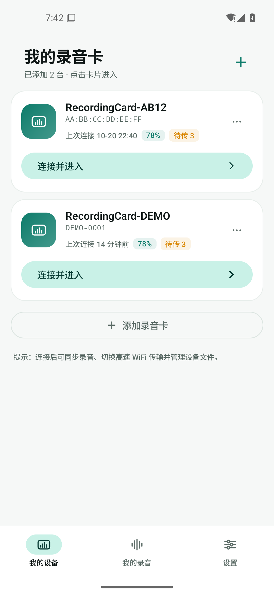
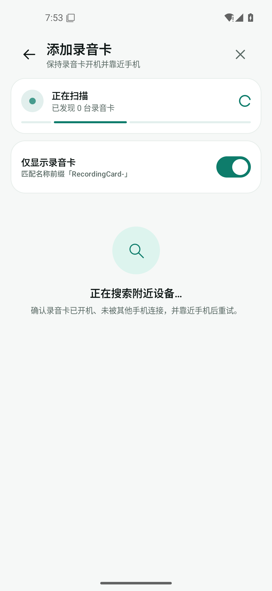
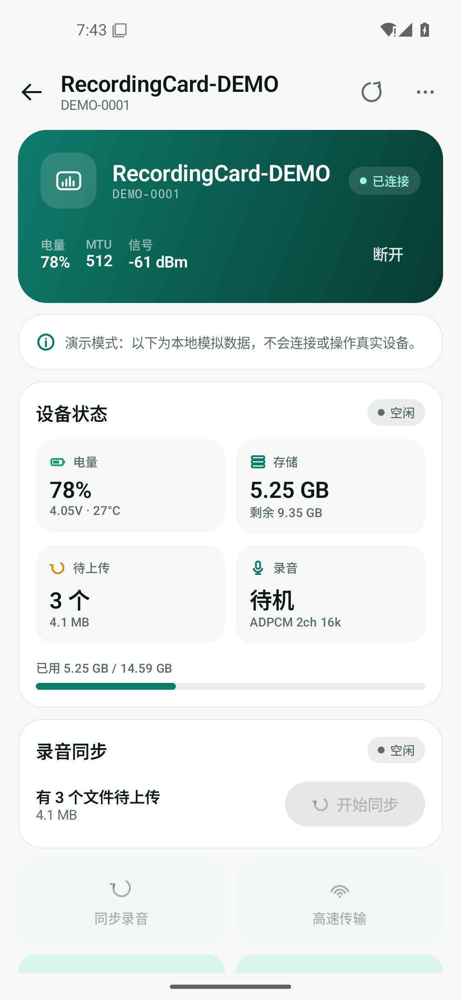
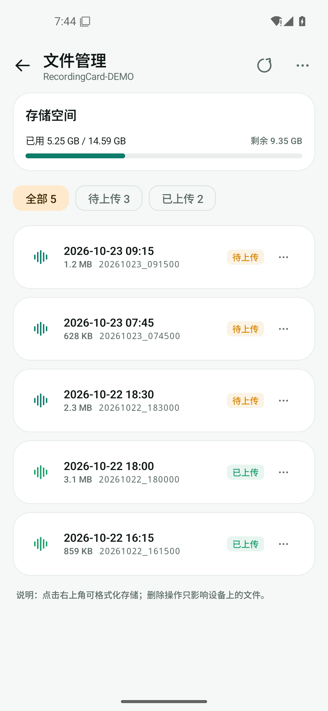
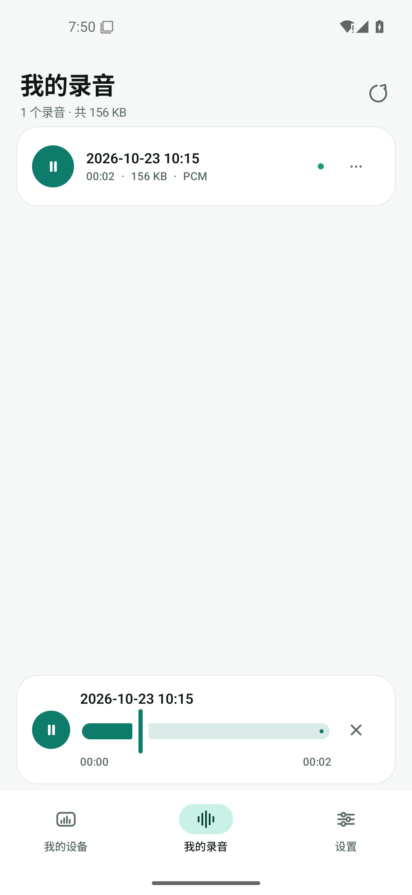
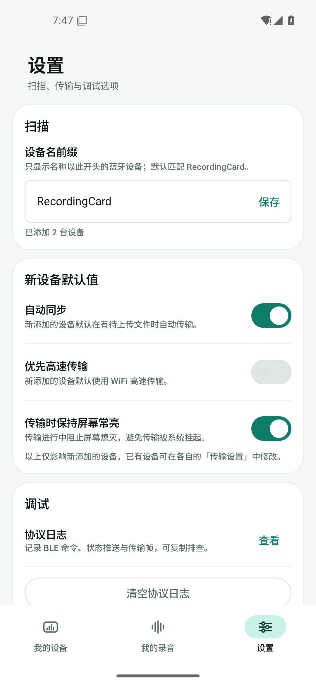
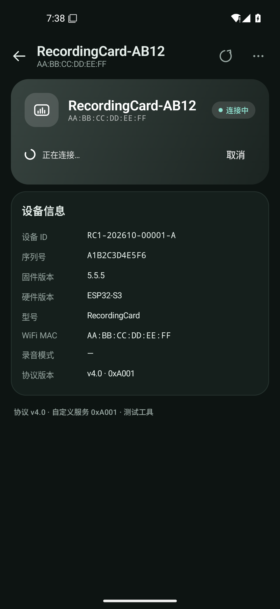

# 录音卡测试 App（Android）

基于录音卡固件仓库 `amoled-ap-release` 分支的最新蓝牙协议
（`docs/ble-protocol-v4.md`，commit `909e4b2`）实现的安卓调试工具。

应用包名 `com.azb.recordcard`，最低支持 Android 10（API 29）。

---

## 1. 功能

| 需求 | 实现 |
| --- | --- |
| 底部导航 | 「我的设备 / 我的录音 / 设置」三个 Tab |
| 扫描过滤 | 默认只显示名称包含 `RecordingCard`（可配置前缀）或 `recording` 的蓝牙设备；可切换显示全部设备 |
| 设备卡片 | 扫描添加后以卡片展示，缓存 MAC、电量、待传数量、上次连接时间 |
| 设备页 | 点击卡片进入并自动回连；连接失败/断开时显示「重新连接」与排查引导 |
| 状态监控 | 电量/电压/温度/充电、存储占用、待传文件、录音状态与实时计时、录音模式、固件/硬件信息 |
| 同步录音 | `0x21` 自动同步队列，逐文件接收、落盘、进度/速度展示，支持停止 |
| 断点续传 | 断连后保存分片；重连后 `0x08` 续传，设备以 `FILE_START(0xFF+offset)` 回传断点 |
| 高速传输 | `0x01` 开启设备热点 → 连接 `RecordingCard-XXXX` → HTTP `GET /api/files`、`/api/file` 下载 → `/api/mark` 标记，完成后 `0x02` 关闭热点 |
| 手动连接兜底 | 系统未弹出/拒绝热点确认（小米/红米等常见）时自动进入手动模式：显示热点名 → 打开 WLAN 设置 → 连上后点「我已连接」，App 探测 `192.168.4.1` 后继续下载 |
| 通知 | 创建「传输状态」通知渠道，首次启动请求通知权限，蓝牙/高速传输期间显示进度通知 |
| 传输中切换 | 蓝牙传输中点击「切换高速」：先 `0x06` 停止当前传输，再开启热点并重新下载 |
| 自动传输 | 每台设备可配置「有待上传文件时自动开始传输」；连接后或录音结束产生新文件时自动发起 |
| 文件管理 | `0x34` 全量列表、`0x31` 删除、`0x35` 标记待传、`0x13` 标记已传、`0x32` 格式化、`0x33` 容量查询 |
| 本地录音库 | 同步完成的录音保存在应用目录，可播放、分享、删除，显示时长/大小/格式/来源设备 |
| 协议日志 | 记录连接、命令、状态 JSON、传输帧与错误，支持级别过滤与一键复制 |
| 演示模式 | 「设置 → 调试 → 添加演示设备」可在无硬件时预览设备页、状态卡、文件管理等界面（本地模拟数据，不会发送任何命令） |

自动校时：每次连接后发送 `0x41`（Unix 时间戳 + 时区偏移），保证录音文件名为真实时间。

---

## 2. 协议实现要点

- 服务 `0xA001`，特征 `0xA102`（文件列表）、`0xA103`（文件帧）、`0xA104`（控制）、
  `0xA105`（状态）、`0xA107`–`0xA109`（身份）；标准服务 `0x180F`、`0x180A` 同步读取。
- 连接后请求 MTU 512，并订阅 `0xA102/0xA103/0xA105/0xA10C/0x2A19` 的通知。
- `0xA105` 兼容两类 JSON：全量状态（含 `recording`/`battery`/`transfer`）与瞬态补丁
  （`cmd_rsp`、`ap_*`、`storage`、`rec_mode`）。
- 文件帧 CRC-16/XMODEM 校验；按 12 帧一个信用窗口回写 `0xA104 0x07` 流控 ACK，
  载荷是**期望收到的下一个 DATA 帧序号**（小端 2B `ack_seq`），不是窗内计数。
- ACK 只在发送成功后才扣减窗口计数，失败时保留计数；发送失败会立即重试一次（30ms），
  之后每 250ms 补发、最多 3 次，总预算 2s —— 远小于设备侧 10s 的 credit 超时。
  不做"重试到成功"：多发一个 ACK 就是多一窗信用，会把设备发送缓冲灌爆。
- 续传时若设备给的断点大于本地分片长度，**直接判失败并整文件重传**，绝不用 0 补齐：
  `FILE_END` 的总长是绝对值，补零能骗过长度校验，产出"时长正常、内容全空"的坏文件。
- 文件名（file id）按 `yyyyMMdd_HHmmss` 解析并格式化展示。
- 应用版本读 `0x2A28`（Software Revision）；`0x2A26` 上报的是 IDF 版本（形如 `v5.5.5`），
  不能用于界面展示或版本门控。
- 高速传输使用 `WifiNetworkSpecifier` 连接设备开放热点，HTTP 请求绑定到该 Network，
  不依赖默认网络，避免「热点无互联网」导致请求走蜂窝网络。
- 设备热点约 90 秒无下载会自动关闭；App 完成/取消后会主动发送 `0x02`。

### 互斥与拒绝条件

界面会按协议限制操作：录音中不能开启热点/高速传输；OTA 激活、WiFi AP 激活时不能进行
BLE 传输；WiFi AP 激活时不能发起蓝牙同步。设备返回的 `cmd_rsp.ok=false` 会以 Snackbar 提示。

### 传输层（GATT）

GATT 传输由 [Nordic Android-BLE-Library](https://github.com/NordicSemiconductor/Android-BLE-Library)
承担（`no.nordicsemi.android:ble` + `ble-ktx` 2.11.0，BSD-3-Clause）：连接与 133 重试、服务发现、
"同一时刻只跑一个 GATT 操作"的请求队列、MTU 协商、CCCD 订阅、请求级超时都由库负责。
`ble/BleConnection` 只是门面，对外仍是 `write(): Boolean` / `read(): ByteArray?`，
协议层与业务层不感知库的存在。

连接参数（interval / latency / 超时）会在每次变化时记录到协议日志，并按 Apple
《Accessory Design Guidelines》的连接参数规则体检：

```
I/BLE: 连接参数 interval=30.00ms latency=0 timeout=6000ms
W/BLE: 连接参数不满足 Apple 规则（iOS 可能拒绝或忽略）: 间隔不是 15ms 的整数倍
```

Android 侧没有直接设定连接间隔的 API，只能用 `requestConnectionPriority()` 提三档建议；
外设发起的连接参数更新由系统蓝牙栈决定是否采纳，App 既看不到也无法同意/拒绝。

---

## 3. 权限

| 权限 | 用途 |
| --- | --- |
| `BLUETOOTH_SCAN` / `BLUETOOTH_CONNECT`（Android 12+） | 扫描与连接录音卡 |
| `ACCESS_FINE_LOCATION`（Android 12 及以下） | 旧系统扫描蓝牙；Android 10–12 的 WiFi 连接请求也依赖它 |
| `NEARBY_WIFI_DEVICES`（Android 13+） | 连接设备热点 |
| `ACCESS_LOCAL_NETWORK`（Android 17+） | 访问录音卡热点上的 `192.168.4.1`；targetSdk 37 必须运行时申请，否则局域网 socket 会被系统静默丢弃（浏览器不受影响） |
| `POST_NOTIFICATIONS`（Android 13+） | 传输进度通知；部分 ROM 的系统热点确认也依赖通知通道 |
| `CHANGE_NETWORK_STATE` | `requestNetwork` / `WifiNetworkSpecifier` 必需（普通权限，安装即授予） |
| `INTERNET` / `ACCESS_NETWORK_STATE` / `ACCESS_WIFI_STATE` / `CHANGE_WIFI_STATE` | 热点连接与 HTTP 下载 |

进入「添加录音卡」或设备页时会引导授权；首次启动会请求通知权限。Android 10+ 连接设备热点
会弹出系统确认框，需要点击允许；授权后 App 通过该热点网络直接访问 `192.168.4.1`。
若系统始终不弹确认框，App 会转入手动连接模式（见第 9 节）。

---

## 4. 构建

环境：JDK 17+（编译目标 Java 17）、Android SDK Platform 37、Gradle 9.5（wrapper 已固定）。
首次构建需要能访问 Maven Central（GATT 传输层依赖 `no.nordicsemi.android:ble`）。当前工程已在
Android 15（API 35）模拟器上完成安装、启动、页面与播放的冒烟验证。

```powershell
cd test-app
.\gradlew.bat :app:assembleDebug
```

产物：`app/build/outputs/apk/debug/app-debug.apk`（`dist/` 下的演示 APK 未纳入版本库）。

> 网络提示：本机访问 `services.gradle.org` 会超时，构建前已将 Gradle 9.5 放入 wrapper
> 缓存。换机器时若下载失败，可把 `gradle/wrapper/gradle-wrapper.properties` 中的
> `distributionUrl` 改为 `https://downloads.gradle.org/distributions/gradle-9.5.0-bin.zip`。
> 若 Android Studio 重新生成 `gradle/gradle-daemon-jvm.properties`（要求 JDK 25），而本机
> 只有 JDK 21，可删除该文件后重试（工程内保留了 `.bak`）。

单元测试：

```powershell
.\gradlew.bat :app:testDebugUnitTest
```

覆盖 CRC-16、帧编解码、状态 JSON、文件列表分块、WAV 时长解析等。

---

## 5. 使用流程

1. 录音卡开机，靠近手机。
2. 「我的设备」→ 右上角 `+` → 授予蓝牙权限 → 等待发现 `RecordingCard-XXXX` → 点击连接。
3. 进入设备页查看状态；有待传文件时可点「同步录音」，或在设置中开启自动传输。
4. 需要更快速度时点「高速传输」；蓝牙传输中也可点「切换高速」。
5. 「文件管理」查看/删除/标记设备文件；「我的录音」播放已下载的录音。
6. 没有硬件时，可在「设置 → 调试」添加演示设备，预览已连接界面与文件列表。

本地录音保存位置：
`Android/data/com.azb.recordcard/files/Music/RecordCard/`

---

## 6. 界面预览

截图使用内置的演示设备（本地模拟数据），真实设备连接后的界面一致。

<table>
  <tr>
    <td align="center"><br/><sub>我的设备</sub></td>
    <td align="center"><br/><sub>添加录音卡</sub></td>
    <td align="center"><br/><sub>设备页</sub></td>
  </tr>
  <tr>
    <td align="center"><br/><sub>文件管理</sub></td>
    <td align="center"><br/><sub>我的录音</sub></td>
    <td align="center"><br/><sub>设置</sub></td>
  </tr>
  <tr>
    <td align="center"><br/><sub>深色主题</sub></td>
  </tr>
</table>

---

## 7. 代码结构

```
app/src/main/java/com/azb/recordcard/
├── app/            AppController（应用级状态机）、SessionState
├── ble/            GATT 门面（Nordic BLE 库）、扫描、文件帧接收与流控
├── protocol/       CRC16、帧编解码、命令码、状态 JSON、文件列表
├── wifi/           SoftAP 连接、HTTP 下载/标记
├── data/           设备持久化、本地录音库
├── audio/          WAV 头解析、MediaPlayer 播放
├── core/           协议日志
└── ui/             Compose 页面、组件、主题
```

---

## 8. 已知限制

- 未实现 OTA（`0xA10A/0xA10B/0xA10C`）与实时音频流（`0xA106`）：本工具聚焦录音同步与文件管理。
- 同一时间只维护一台录音卡的连接；切换设备会断开上一台。
- 传输依赖前台运行（未使用前台服务）；传输期间默认保持屏幕常亮，可在设置中关闭。
- 传输期间不发起状态/电量/RSSI 刷新（避免与流控 ACK 抢 GATT 请求队列），但 ACK 与其它写仍共用
  同一条 FIFO 队列，没有优先级抢占。
- 传输失败（如设备侧 credit 超时）后不会自动给出「继续传输」入口，只能等设备挂起会话超时后
  重新全量同步。
- 连接参数：外设发起的「由慢变快」更新在部分 Android 机型上会被系统拒绝或覆盖，快速档通常
  需要 App 侧 `requestConnectionPriority(HIGH)` 触发（当前未接线，参数变化只记录日志）。
- 高速传输优先使用系统 `WifiNetworkSpecifier` 弹窗；部分 ROM 会拦截该弹窗，此时使用手动连接兜底。
- 断点续传依赖设备内存中的挂起会话（5 分钟），超时后只能重新全量同步。
- 仓库内提供的是 debug 签名 APK，可直接安装测试；如需正式分发请配置自己的签名。

---

## 9. 高速传输连不上设备热点？

> **Android 17（API 37）本地网络限制**：系统默认禁止应用访问局域网。App 必须声明并在
> 运行时申请 `ACCESS_LOCAL_NETWORK`；否则连接 `192.168.4.1` 的 socket 会超时或报
> `ENONET`，而浏览器（有豁免）仍能打开。1.0.9 已适配，点「高速传输」时按提示允许
> 「本地网络」即可。

> 1.0.1 及以前版本缺少 `CHANGE_NETWORK_STATE`，系调用 `requestNetwork` 时会直接抛
> `SecurityException`（"was not granted either of these permissions:
> CHANGE_NETWORK_STATE, WRITE_SETTINGS"），系统弹窗根本不会出现。1.0.2 已补上该普通权限。

1. 点「高速传输」后若系统弹出「连接 WLAN 网络」，点允许；App 会自动下载。
2. 若系统直接返回失败（小米/红米 HyperOS 常见），App 会显示「手动连接」卡片：
   记住卡片上的热点名（`RecordingCard-XXXX`，无密码）→ 点「打开 WLAN 设置」→ 在系统
   WLAN 列表连接该热点 → 返回 App 点「我已连接」。App 探测 `192.168.4.1` 成功后继续下载。
3. 小米/红米：应用信息 → 权限管理 → 其他权限 → 允许「后台弹出界面」；同时在通知设置中
   允许通知。Android 13+ 首次启动会请求通知权限。
4. 传输期间临时关闭「WLAN+ / 智能选网 / 自动切换网络」，避免系统切回原 WiFi；
   设备热点约 90 秒无下载会自动关闭，手动连接请尽快完成。
5. 若设备状态卡显示「存储：未挂载」，请检查录音卡 SD 卡是否插好/重新上电，否则 HTTP
   文件列表同样会失败。
6. 若已连上热点（手机拿到 `192.168.4.x`）但 `192.168.4.1:80` 超时：1.0.5 会在自动连接的网络
   无法访问 HTTP 时**保留 AP** 并自动进入「手动连接」：在系统 WLAN 里连接该热点（与浏览器
   测试同一条链路）→ 返回点「我已连接」，App 用系统 WiFi 网络探测并继续下载。1.0.4 还支持
   「默认网络 / 绑定网络」两种 HTTP 模式自动切换。仍失败时检查设备「存储未挂载」——固件在
   SD 挂载失败时不会启动 HTTP（`Acquire(ApSession)` 失败直接不开 AP，HTTP 启动失败会回滚关 AP）。
7. 1.0.6 在手动确认前对每个候选 WiFi 执行 `bindProcessToNetwork` 再探测，让 App 的 HTTP
   与浏览器走同一条进程路由。若仍提示「未检测到设备 HTTP」，保持连接该热点并用浏览器打开
   `http://192.168.4.1/api/files`：浏览器通而 App 不通，请把协议日志发出来；浏览器也不通，
   则重启录音卡（HTTP 服务未启动/已卡死）。

